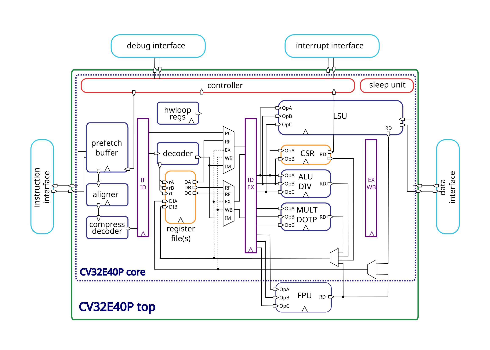

# CV32E40P — do RTL ao GDSII na SAED32

Implementação física do processador RISC-V **CV32E40P** (OpenHW Group, RV32IMC)
como bloco sem pads, com o **Synopsys Fusion Compiler** e a biblioteca
educacional **SAED32** (32 nm), família HVT, a **8 ns (125 MHz)**, analisada em
três corners.

Projeto de Alanna Santos e Apolonio Neto na residência **CI Expert**, polo UFCG,
trilha de Physical Design (2026).

> *English summary:* RTL-to-GDSII implementation of the OpenHW CV32E40P RISC-V
> core (RV32IMC) as a padless hard block, using Synopsys Fusion Compiler and the
> SAED32 32 nm educational library (HVT cells), at 8 ns (125 MHz), analysed in
> three PVT corners. Every design decision is backed by a primary source and a
> written study, and every stage has numeric acceptance criteria. Documentation
> is in Brazilian Portuguese.



*Diagrama de blocos do CV32E40P. Fonte: OpenHW Group, documentação do
cv32e40p (Solderpad Hardware License).*

## Situação

| Etapa | Situação |
|---|---|
| Simulação do RTL (VCS) e lint | scripts prontos (`tool_data/vcs/`, `tool_data/lint/`) |
| Biblioteca (NDM) e corners | scripts prontos; corners definidos pelo databook da biblioteca (estudo E01) |
| **Síntese lógica** (scripts `01` a `03`) | **em andamento**: entrega prevista para o fim de novembro de 2026 |
| Floorplan, alimentação, placement, árvore de clock, roteamento, acabamento (`04` a `09`) | scripts prontos; rodam depois da síntese aceita, com os estudos E09 e E10 antes |

Os resultados entram aqui quando cada etapa passar nos critérios de aceite.
O detalhe do que está em andamento fica em [docs/estado-atual.md](docs/estado-atual.md).

## Como o projeto é feito

O projeto é também um exercício de método, para uma dupla que está aprendendo
projeto físico:

- **Requisitos do projeto acima de tudo** ([requisitos](docs/requisitos-professor.md)).
- **Nada é "confirmado" sem fonte primária**: databook com página e tabela,
  `man` da ferramenta ou requisito ([método](docs/metodo-de-trabalho.md)).
- **Cada decisão tem um estudo**, com o experimento feito pela dupla, uma
  variável por vez ([estudos E01 a E10](docs/estudos/README.md)), e um registro
  ([decisões](docs/decisions.md)).
- **Decisões avançadas** (proibir células, mudar o orçamento de E/S, margens,
  restrições de roteamento) só depois de perguntar ao professor, levando o estudo.
- **Cada etapa tem critério de aceite numérico**, nos três corners
  ([critérios](docs/criterios-aceite.md)). Exemplo: violação de timing aceita
  só se for menor que 0,01 ns.

## Configuração

| Item | Valor |
|---|---|
| RTL | `third_party/cv32e40p`, tag `cv32e40p_v1.8.3` (submódulo, sem alterações) |
| Parâmetros | sem PULP, sem FPU, `NUM_MHPMCOUNTERS=1` |
| Clock | 8 ns (125 MHz) |
| Netlist | flat abaixo do `core_i` |
| Corners | ss 0,95 V 125 °C (Cmax) · tt 1,05 V 25 °C (nominal) · ff 1,16 V −40 °C (Cmin); setup e hold nos três |
| Restrições | SDC derivado do exemplo do upstream (`constraints/cv32e40p_baseline.sdc`) |
| Ferramentas | VCS, VC SpyGlass, Library Manager, Fusion Compiler, Formality, IC Validator |

## Fluxo

| Script | Etapa |
|---|---|
| `tool_data/vcs/` | simulação do RTL ([guia](docs/sim-vcs.md)) |
| `tool_data/lint/lint.tcl` | lint ([guia](docs/lint.md)) |
| `tool_data/fc/create_ndm.tcl` | biblioteca da SAED32 no formato do Fusion Compiler (NDM) |
| `tool_data/fc/00_tech_setup.tcl` | variáveis do projeto e da tecnologia |
| `tool_data/fc/01_init_design.tcl` | leitura do RTL e netlist flat |
| `tool_data/fc/02_scenarios.tcl` | corners, cenários e SDC |
| `tool_data/fc/03_synth.tcl` | síntese lógica e relatórios nos três corners |
| `tool_data/fm/fm.tcl` | equivalência RTL × netlist (Formality) |
| `tool_data/fc/04_floorplan.tcl` a `09_finish.tcl` | floorplan, rede de alimentação, placement, árvore de clock, roteamento com DRC oficial, acabamento e GDS |

Cada script é rodado **bloco a bloco** no `fc_shell`: cada bloco diz o que faz,
por quê, o que conferir e o que mostrar.

## Como rodar

Num servidor com as ferramentas Synopsys e a SAED32 instaladas:

```bash
git clone --recurse-submodules https://github.com/alannasant0s/cv32e40p-asic-flow.git
cd cv32e40p-asic-flow
git config core.hooksPath .githooks          # hook que barra arquivos do PDK
source /Tools/synopsys-scripts/snps.sh       # carrega as ferramentas (ajuste ao seu servidor)
scripts/gen_filelist.sh --synthesis          # lista de arquivos do RTL
lm_shell -x "set VT hvt" -file tool_data/fc/create_ndm.tcl -batch
fc_shell                                      # e então os blocos do 01 ao 03
```

O passo a passo está em [docs/plano-de-trabalho.md](docs/plano-de-trabalho.md).
Os caminhos do PDK ficam em `tool_data/fc/00_tech_setup.tcl`.

## Organização

```
constraints/   SDC
rtl/           wrapper de clock gating para a SAED32
tool_data/     scripts por ferramenta (vcs, lint, fc, fm)
scripts/       ajudantes (filelist, coleta de métricas, PDF)
docs/          requisitos, plano, método, critérios, decisões, estudos, guias
third_party/   RTL do CV32E40P (OpenHW, submódulo)
```

## Uso de IA

O projeto usa assistentes de IA para escrever e revisar textos e scripts. A
dupla roda as ferramentas, confere os resultados e toma as decisões. Detalhes
em [docs/ai-usage.md](docs/ai-usage.md).

## Licença

Os arquivos dos autores são distribuídos sob a **Apache License 2.0**
([LICENSE](LICENSE)). O RTL do CV32E40P, o SDC derivado do exemplo do upstream e
as figuras em `docs/img/` seguem a **Solderpad Hardware License** ([NOTICE](NOTICE)). A biblioteca SAED32 e
as ferramentas Synopsys não fazem parte deste repositório.
